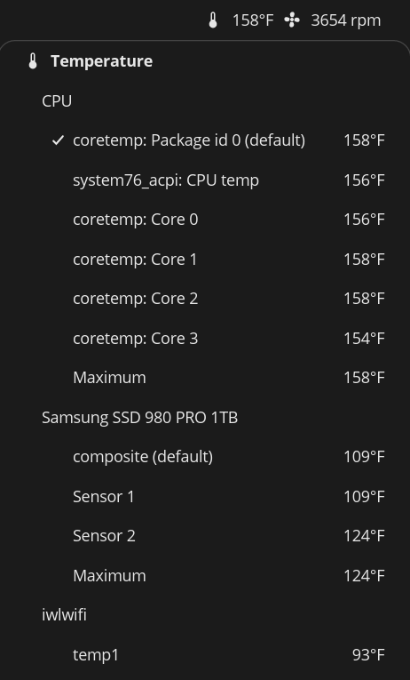

# Puron

Puron is a panel applet for the COSMIC desktop that displays hardware
sensor readings in the COSMIC Panel and Dock.

The goal of Puron is to read and display any sensor that the system
hardware makes available. This includes:
- individual hardware component temperatures (CPU, SATA, GPU, etc.)
- fan speeds
- hardware voltages
- liquid cooling statistics

## Install

Puron is released as a Debian package for 64-bit x86 (amd64) systems.

1. Download `puron_1.2.0_amd64.deb` from the
   [Releases page](https://github.com/elalonde/puron/releases). To check
   the download, also fetch `SHA256SUMS` and run
   `sha256sum --check --ignore-missing SHA256SUMS` in the same folder.
2. Install the package:

       sudo apt install ./puron_1.2.0_amd64.deb

3. Add Puron to a panel in COSMIC Settings, among the panel applets.

To build and install Puron from source instead, see Build below.

## Use

- The panel shows the readings that you have checked in the popup,
  each with its value. When none is checked, it shows a single icon.
- Click Puron in the panel to open the popup, and click it again to
  close it. The popup lists the readings that Puron has found, in
  sections for temperature, fan, voltage and power; temperatures are
  grouped further by device.
- Click a line in the popup to check it, which adds the reading to the
  panel, or to uncheck it. The popup stays open. Puron remembers the
  checked readings.
- When Puron finds no readings, the popup says so: it asks you to
  install lm-sensors, or to run `sensors-detect` (part of the lm-sensors
  package) as root, which sets up the sensor chips of your computer.
- At the bottom of the popup, "Settings" opens the settings window,
  and "About" opens the Puron homepage in your browser.

The settings window holds the following settings. Changes take effect
at once.

- Display Options: how often Puron reads the sensors (in seconds),
  whether the panel shows an icon next to each reading, the temperature
  unit (°C or °F), whether to show the unit of temperatures, rotation
  rates, voltages and power, and whether to show decimals.
- Generic, GPU and Drive Sensor Providers: switch each source of
  readings on or off: lm-sensors and liquidctl, the NVIDIA driver, and
  udisks2 and NVMe for drives. The NVMe switch is labelled "nvme-cli";
  it reads the temperatures from sysfs and does not need the nvme-cli
  program. lm-sensors also reads the drives that the kernel reports
  (NVMe drives, and SATA drives with the `drivetemp` module). The
  switch "lm-sensors (drives)" turns only those off: Puron then no
  longer asks the drives for their temperature, which lets a hard disk
  spin down, and the other lm-sensors readings stay.
- Show Sensors: which kinds of readings appear: temperature, rotation
  rate (fan speeds), voltage and power.

## Run-time dependencies

- `libsensors5` (required).
- Optional, each for one provider: the NVIDIA driver
  (`libnvidia-ml.so.1`), the udisks2 service (SATA drives), and the
  `liquidctl` program.

NVMe temperatures come from sysfs and need nothing more.

## Known limits

- On a computer with two NVIDIA GPUs where one is asleep, the sleeping
  GPU may be woken at each update. The NVIDIA provider can be switched
  off in the settings.
- liquidctl support is tested against recorded output, not against real
  devices.

## Build

Get the source:

    git clone https://github.com/elalonde/puron.git
    cd puron

Install rustup (see https://rustup.rs; it fetches the toolchain version
pinned in `rust-toolchain.toml`), make, a C toolchain, and these build
packages:

    sudo apt install clang libsensors-dev libwayland-dev libxkbcommon-dev pkg-config

Then build Puron. `make install-bin` builds the two programs,
`puron-applet` and `puron-settings`, and copies them into
`$DESTDIR/usr/bin`; `cargo build --release` only builds them:

    make install-bin DESTDIR=/tmp/puron-root   # or: cargo build --release

`make install PREFIX=/usr/local` builds and installs the programs, their
icons and the applet's desktop entry under `/usr/local`, without a
package. It needs write access to `/usr/local`.

To build the Debian package yourself, you also need python3, the
dpkg-dev package, and network access for cargo to download the crates
listed in `Cargo.lock`:

    make deb      # writes the package to target/deb/

## Test

    make setup    # once per clone: enables the commit-msg hook
    make check

`make check` runs rustfmt, clippy, the build, the whole test suite and
the script checks under `tools/`. Some of the script checks build
Puron in release mode, so a full run can take a long time.

The test suite needs more than the build. On Debian or Ubuntu, install:

    sudo apt install dbus jq libsensors5 lm-sensors locales umockdev
    sudo locale-gen tr_TR.UTF-8 de_DE.UTF-8

It also needs cargo-deny, a journald that stores debug messages, a
user who is not root, and the COSMIC icon theme in
`/usr/share/icons/Cosmic` (the CI workflow in `.github/workflows/ci.yml`
shows how to install cargo-deny and the theme). Run
`sh tools/check-test-host.sh` to list what is still missing; it also
names the exact versions of rustc and cargo-deny that the tests
expect. The tests do not skip themselves: a test that
needs something the computer lacks fails, and its message names what is
missing.

## License

Puron's source files are MIT; see `LICENSE`.

The `puron-applet` binary links `cosmic-panel-config` and
`xdg-shell-wrapper-config` (GPL-3.0-only) and is therefore distributed
as a GPL-3.0 combined work; see `data/licenses/GPL-3.0.txt`. It also
links the libcosmic crates and `option-ext` (MPL-2.0), `udisks2`
(LGPL-2.1) and crates under permissive licenses.

The `puron-settings` binary is MIT and links the libcosmic crates and
`option-ext` (MPL-2.0) and crates under permissive licenses.

The package ships the GPL-3.0 text, `SOURCE-OFFER` and
`THIRD-PARTY-NOTICES.txt` in `/usr/share/doc/puron/`. The notices file
lists every crate in `Cargo.lock` with its license and notices.

The complete corresponding source of the binaries is the release asset
`puron-1.2.0-source.tar.xz` of the tag `v1.2.0`: Puron's full source
with the locked dependencies vendored and the cargo config for an
offline build. `make source-archive` writes this archive to
`target/source/`, and `sh tools/check-source-archive.sh` checks that it
builds offline:

    make source-archive
    sh tools/check-source-archive.sh

## History

Puron started as a clean-room re-implementation of the GNOME Shell
extension Freon. It is a new program written from scratch, not a copy
of Freon's code. (Puron is the refrigerant that replaced Freon after
Freon was banned for its contribution to ozone depletion.) The project
has since moved on from its original intent, in order to support more
modern environments.
