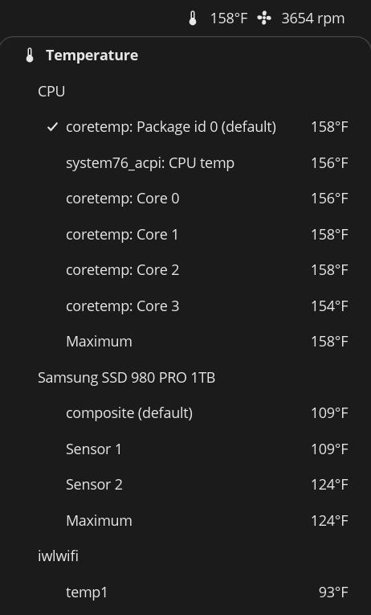

# Puron

Puron is a panel applet for the COSMIC desktop that displays hardware
sensor readings in the COSMIC Panel and Dock.

The goal of Puron is to read and display any sensor that the system
hardware makes available. This includes:
- individual hardware component temperatures (CPU, SATA, GPU, etc.)
- fan speeds
- hardware voltages
- liquid cooling statistics

## Install

Puron is released as a Debian package for 64-bit x86 (amd64) systems.

1. Download `puron_1.7.0_amd64.deb` from the
   [Releases page](https://github.com/elalonde/puron/releases). To check
   the download, also fetch `SHA256SUMS` and run
   `sha256sum --check --ignore-missing SHA256SUMS` in the same folder.
2. Install the package:

       sudo apt install ./puron_1.7.0_amd64.deb

3. Add Puron to the panel: open COSMIC Settings, go to
   Desktop > Panel > Applets, click "Add applet" and choose Puron.
   If Settings was already open during the install, close it and open
   it again first: Settings does not list an applet that was installed
   while it was running, so Puron would not show among the applets.

To build and install Puron from source instead, see Build below.

## Flatpak

Puron is also packaged as a Flatpak for the COSMIC Store, published in
the COSMIC Flatpak repository, which the store reads. A release shows in
the store when that repository has taken it in.

After installing the Flatpak, add Puron to the panel as for the Debian
package: open COSMIC Settings, go to Desktop > Panel > Applets, click
"Add applet" and choose Puron. If Settings was already open during the
install, close it and open it again first, or Puron does not show among
the applets.

The Flatpak does not read liquidctl devices; the Debian package does.

The Flatpak and the Debian package share their settings: a move from one
to the other keeps every setting and every pinned reading.

The Flatpak's programs are licensed as the Debian package's are (see
License). The Flatpak also holds the lm-sensors library, libsensors,
which is LGPL-2.1-or-later; its source is in the release's source
archive, `puron-<version>-source.tar.xz`.

## Use

- The panel shows the readings that you have checked in the popup,
  each with its value. When none is checked, it shows a single icon.
- Next to each value, the panel shows an icon, unless you switch panel
  icons off in the settings. A temperature has the icon of its kind of
  device: CPU, GPU, drive, Wi-Fi, wired network or memory, and a
  thermometer for any other device, so that two temperatures can be
  told apart at a glance. Fans, voltages and power have icons of their
  own.
- Click Puron in the panel to open the popup, and click it again to
  close it. The popup lists the readings that Puron has found, in
  sections for temperature, fan, voltage and power; temperatures are
  grouped further by device.
- Click a line in the popup to check it, which adds the reading to the
  panel, or to uncheck it. The popup stays open. Puron remembers the
  checked readings.
- When Puron finds no readings, the popup says so: it asks you to
  install lm-sensors, or to run `sensors-detect` (part of the lm-sensors
  package) as root, which sets up the sensor chips of your computer.
- At the bottom of the popup, "Settings" shows the settings on a page of
  the popup, and "Back" on that page shows the readings again. "About"
  shows the About page in the popup: the version of Puron, how it was
  packaged, its license, the state of each source of readings, and links
  to the homepage, the source code, the issue tracker and the
  third-party notices, with a button "Copy details" that copies these
  facts for a bug report.

The Settings page holds the following settings. Changes take effect at
once.

- Display Options: how often Puron reads the sensors (in seconds),
  whether the panel shows an icon next to each reading, the text size of
  the readings when Puron is on a panel ("Panel Text Size") and when it
  is on a dock ("Dock Text Size"), the temperature unit (°C or °F),
  whether to show the unit of temperatures, rotation rates, voltages and
  power, and whether to show decimals.
- Generic, GPU and Drive Sensor Providers: switch each source of
  readings on or off: lm-sensors and liquidctl, the NVIDIA driver, and
  udisks2 and NVMe for drives. The NVMe switch is labelled "nvme-cli";
  it reads the temperatures from sysfs and does not need the nvme-cli
  program. lm-sensors also reads the drives that the kernel reports
  (NVMe drives, and SATA drives with the `drivetemp` module). The
  switch "lm-sensors (drives only)" turns only those off: lm-sensors then no
  longer asks the drives for their temperature, so that lm-sensors no
  longer keeps a hard disk from spinning down, and the other lm-sensors
  readings stay.
- Show Sensors: which kinds of readings appear: temperature, rotation
  rate (fan speeds), voltage and power.

## Run-time dependencies

- `libsensors5` (required).
- Optional, each for one provider: the NVIDIA driver
  (`libnvidia-ml.so.1`), the udisks2 service (SATA drives), and the
  `liquidctl` program.

NVMe temperatures come from sysfs and need nothing more.

## Known limits

- On a computer with two NVIDIA GPUs where one is asleep, the sleeping
  GPU may be woken at each update. The NVIDIA provider can be switched
  off in the settings.
- liquidctl support is tested against recorded output, not against real
  devices.

## Build

Get the source:

    git clone https://github.com/elalonde/puron.git
    cd puron

Install rustup (see https://rustup.rs; it fetches the toolchain version
pinned in `rust-toolchain.toml`), make, a C toolchain, and these build
packages:

    sudo apt install clang libsensors-dev libwayland-dev libxkbcommon-dev pkg-config

Then build Puron. `make install-bin` builds the program `puron-applet`
and copies it into `$DESTDIR/usr/bin`; `cargo build --release` only
builds it:

    make install-bin DESTDIR=/tmp/puron-root   # or: cargo build --release

`make install PREFIX=/usr/local` builds and installs the program, its
icons and the applet's desktop entry under `/usr/local`, without a
package. It needs write access to `/usr/local`.

To build the Debian package yourself, you also need python3, the
dpkg-dev package, and network access for cargo to download the crates
listed in `Cargo.lock`:

    make deb      # writes the package to target/deb/

`make source-archive` writes the release's source archive to
`target/source/`. It needs network access too: besides the crates, it
fetches the source of the lm-sensors release that the Flatpak bundles.

To build the Flatpak, you need flatpak, flatpak-builder, git, curl, and
python3 with its modules aiohttp and tomlkit (Debian: python3-aiohttp,
python3-tomlkit), the Flathub remote, and network access. The build uses
the runtime `org.freedesktop.Platform` and the SDK `org.freedesktop.Sdk`
of the branch named in `flatpak/io.github.elalonde.Puron.json`, with the
SDK extensions listed there; the script says which of them are missing,
or installs them from Flathub with `PURON_FLATPAK_INSTALL_DEPS=1`. The
script builds in `~/.cache/puron-flatpak` and writes one bundle file,
which you then install for your user:

    sh tools/flatpak-build.sh        # writes /tmp/puron-test.flatpak
    flatpak install --user /tmp/puron-test.flatpak

## Test

    make setup    # once per clone: enables the commit-msg hook
    make check

`make check` runs rustfmt, clippy, the build, the whole test suite and
the script checks under `tools/`. Some of the script checks build
Puron in release mode, so a full run can take a long time.

The test suite needs more than the build. On Debian or Ubuntu, install:

    sudo apt install dbus jq libsensors5 lm-sensors locales umockdev
    sudo locale-gen tr_TR.UTF-8 de_DE.UTF-8

It also needs cargo-deny, a journald that stores debug messages, a
user who is not root, and the COSMIC icon theme in
`/usr/share/icons/Cosmic` (the CI workflow in `.github/workflows/ci.yml`
shows how to install cargo-deny and the theme). Run
`sh tools/check-test-host.sh` to list what is still missing; it also
names the exact versions of rustc and cargo-deny that the tests
expect. The tests do not skip themselves: a test that
needs something the computer lacks fails, and its message names what is
missing.

## Translating Puron

Puron shows its texts in the language of your desktop when a
translation exists, and in English otherwise. Each translation is
one file, `i18n/<language code>/puron.ftl`, in the Fluent format
(https://projectfluent.org).

To add a language:

1. Copy `i18n/en/puron.ftl` to `i18n/<language code>/puron.ftl`.
   The code is the language, such as `de` or `fr`, or the language
   and the country, such as `pt-BR`, with a hyphen and not an
   underscore.
2. Translate the text after each `=`. Keep the name before the `=`
   as it is, and keep every part in `{ }` as it is: `{" "}` keeps
   a space that Fluent would otherwise drop.
3. Translate what you can. A partial file is welcome: each text
   that it leaves out is shown in English.
4. Open a pull request.

`make check` prints one line for each translation, with the number
of texts it translates and any line that Puron cannot read. A
translation never makes `make check` fail: a text that Puron
cannot read is shown in English.

## License

Puron's source files are MIT; see `LICENSE`.

Puron's one binary, `puron-applet`, links `cosmic-panel-config` and
`xdg-shell-wrapper-config` (GPL-3.0-only) and is therefore distributed
as a GPL-3.0 combined work; see `data/licenses/GPL-3.0.txt`. It also
links the libcosmic crates and `option-ext` (MPL-2.0), `udisks2`
(LGPL-2.1) and crates under permissive licenses.

The package ships the GPL-3.0 text, `SOURCE-OFFER` and
`THIRD-PARTY-NOTICES.txt` in `/usr/share/doc/puron/`. The notices file
lists every crate in `Cargo.lock` with its license and notices.

The complete corresponding source of the binary is the release asset
`puron-1.7.0-source.tar.xz` of the tag `v1.7.0`: Puron's full source
with the locked dependencies vendored and the cargo config for an
offline build. `make source-archive` writes this archive to
`target/source/`, and `sh tools/check-source-archive.sh` checks that it
builds offline:

    make source-archive
    sh tools/check-source-archive.sh

## History

Puron started as a clean-room re-implementation of the GNOME Shell
extension Freon. It is a new program written from scratch, not a copy
of Freon's code. (Puron is the refrigerant that replaced Freon after
Freon was banned for its contribution to ozone depletion.) The project
has since moved on from its original intent, in order to support more
modern environments.
